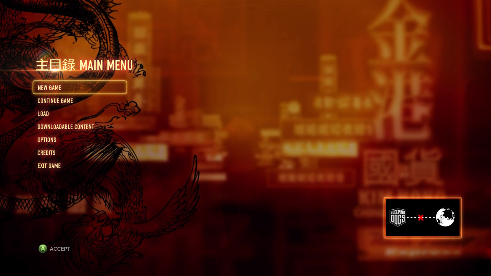
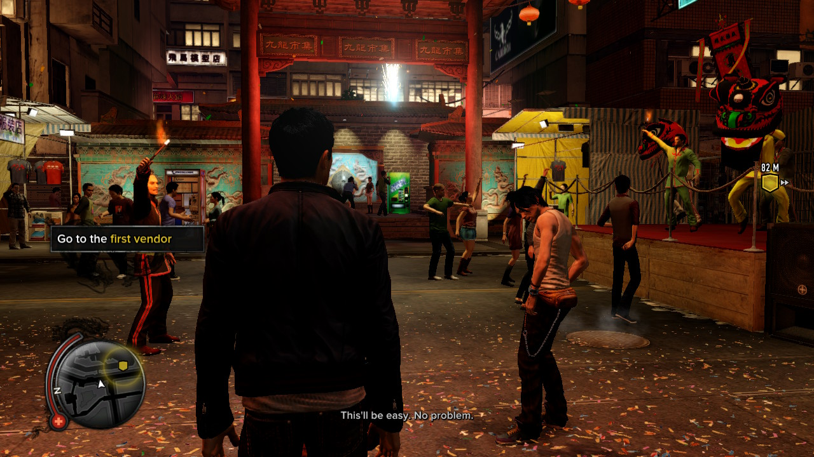
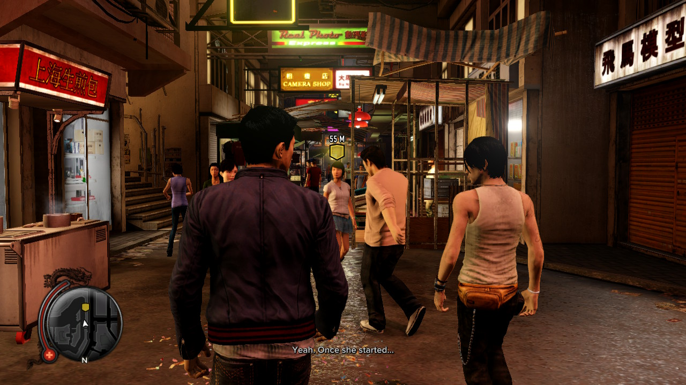
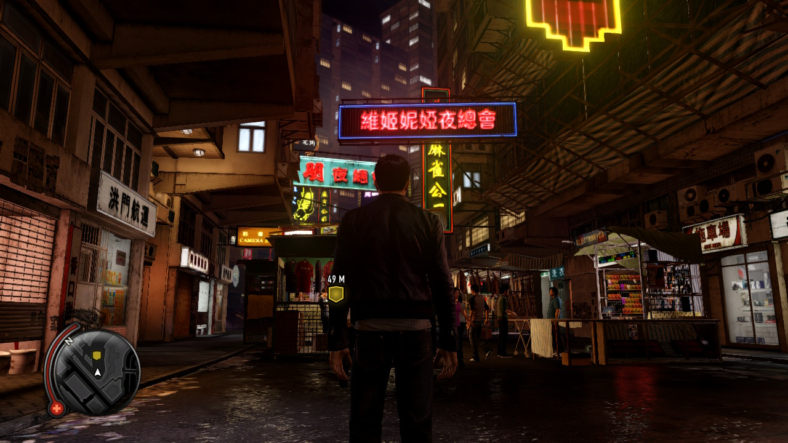
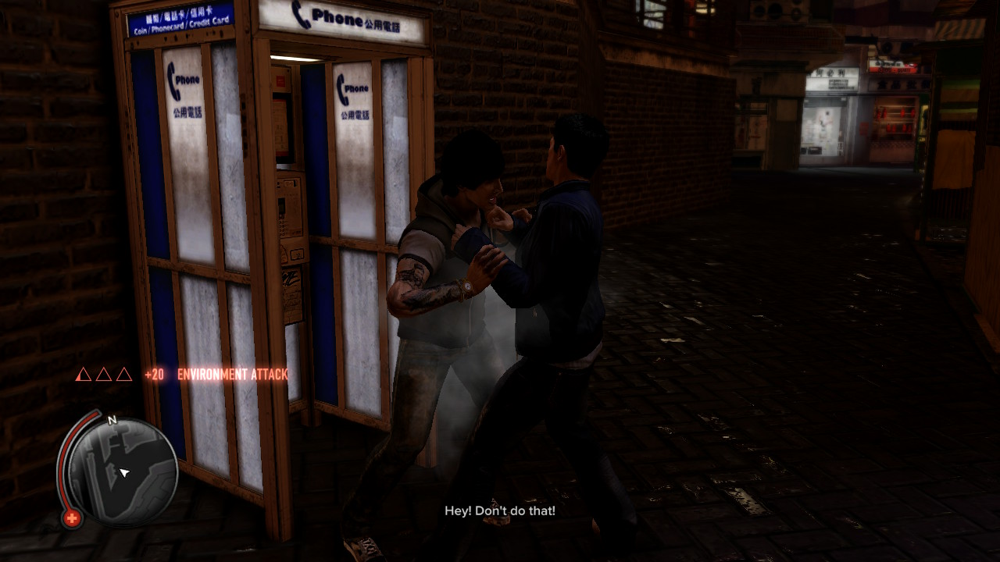
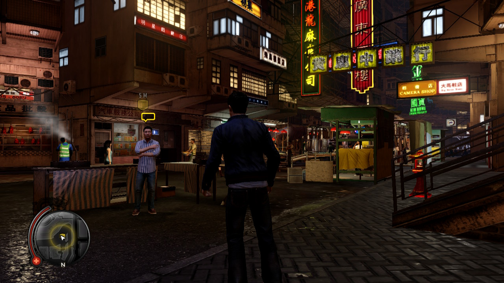

# FEXTendo / Sleeping Dogs NX

FEXTendo is a Nintendo Switch launcher and compatibility **wrapper for the
original Windows PC version of Sleeping Dogs** (`HKShip.exe`, x86). It uses
Wine, FEX-Emu and DXVK to run the PC game. This repository contains the
Sleeping Dogs integration, runtime patches, build tools and test records.

The **Switch port and Horizon/Wine integration of FEX-Emu** are developed by
**AndroSwitch Project / Ibnuard**, continuing our PES13/FEXTendo work. The CPU
translation engine is upstream FEX-Emu; the Wine/Horizon runtime foundation
comes from Wine-NX / Autorun. See [credits and source provenance](THIRD_PARTY.md).

**Provide your own installed original PC game.** Game executables, game data,
saves, `lossless.dll` and proprietary LSFG shaders are not supplied in this
repository or release packages. The x64 **Definitive Edition is not supported**.

[Installation](docs/INSTALL.md) · [Settings](docs/CONFIGURATION.md) ·
[Troubleshooting](docs/TROUBLESHOOTING.md) · [All documentation](docs/README.md)

## Current status

Version **0.1.1** fixes failed launch when `.pandora` startup configuration was
lost during copying. The NRO restores missing defaults automatically, including
the intentional empty `local` file, and preserves existing configuration.
See [release notes](release/NOTES.md).

Gameplay is confirmed on a Switch OLED. The user reports the latest
[launcher v4](docs/launcher-v4.md) working well and supplied the screenshots
below. Its native COM and Present optimizations are retained in
[production v1](docs/production-v1.md), which removes normal diagnostic writes
while preserving system persistence and last played.

Production v1's quiet launch is reported working by the owner. Version 0.1.1's
automatic config repair still needs a Switch test. Earlier Light 720p reports were around
20–22 FPS with scene-dependent drops and confined-view peaks near 30.
**Stable 30 FPS is not established; screenshots are not a benchmark.**

| Area | Status |
| --- | --- |
| Runtime | Wine/FEX, v17 scheduler, FEX context improvements, native inline COM |
| Graphics | Native ARM64 DXVK over Mesa/NVK; retained x86 renderer comparisons |
| Game detail | Mandatory Light 1280×720 |
| Normal Play | No diagnostic files; settings, caches, saves and last played retained |
| Launcher | Cached System Check, required low-memory patch, keyboard, DXVK HUD, optional LSFG |
| Debug | Enable **Settings → Show debug launch**, then select **Launch Debug** |
| Distribution | Complete runtime packaging and automatic release after a PR merges to `main`; [pipeline details](docs/RELEASE.md) |

See [current status and test evidence](docs/STATUS.md) for known issues,
hardware conditions and the difference between native FPS and frame generation.

## Setup

1. Obtain a **complete Sleeping Dogs runtime package** and its matching
   forwarder. A GitHub source ZIP, standalone NRO or update ZIP does not contain
   everything needed for a fresh installation. See [package types](docs/INSTALL.md#packages).
2. Extract the package's `switch/` folder to the SD root. Copy your own game
   installation into `switch/sleepingdogs-fex/drive_c/SleepingDogs/`, keeping the
   package's `d3d9.dll`, `d3d11.dll`, `dxgi.dll` and `dxvk.conf`.
3. Use the matching **FEXTendo Memory v1 TEST** environment and Sleeping Dogs
   **39-bit + guest low-window** forwarder. Its target is
   `sdmc:/switch/sleepingdogs-fex/sleepingdogs-fex.nro`. Follow the
   [boot and forwarder requirements](docs/INSTALL.md#boot-and-forwarder).
4. Launch Sleeping Dogs from HOME. For a native-FPS baseline, use DXVK Native ARM64,
   FEX Fastest, LSFG OFF and 1280×720. Close the application from HOME before
   applying an update.

Expected layout at the SD root; keep the other runtime files supplied by the
complete package:

```text
switch/sleepingdogs-fex/
├── sleepingdogs-fex.nro
├── configuration.ini
├── launcher/                         # assets, renderer sets and preferences
├── drive_c/
│   ├── SleepingDogs/
│   │   ├── HKShip.exe                # your original x86 PC game
│   │   ├── Data/                     # your game data
│   │   ├── ...                       # all BIG/BIX and other installed files
│   │   ├── d3d9.dll                  # package-supplied DXVK
│   │   ├── d3d11.dll
│   │   ├── dxgi.dll
│   │   ├── sdndx4.dll                # x86 → native COM bridge
│   │   └── dxvk.conf
│   └── windows/                      # package-supplied Wine/FEX modules
└── share/wine/                       # runtime fonts and NLS data
```

For an existing compatible installation, close from HOME and copy **only the
main `switch/` folder** to the SD root, replacing supplied files. No `start-game`
folder is needed. Keep your game, saves and existing personal LSFG pack.

The launcher graphics profiles configure DXVK. Production always applies
Light 720p to the game's display options before Play/Debug; there is no quality
selector. The `Graphics Level: undefined` label remains unresolved.
Installation details, updates and log locations are in the
[documentation index](docs/README.md).

## Screenshots

Captured by the tester on Switch; the original supplied images are unchanged.

| Main menu | Night market |
| --- | --- |
|  |  |
| Market crowd | Neon street |
|  |  |
| Combat | Street vendor |
|  |  |

## Development

Start with the [build guide](docs/BUILD.md) and [contributing guide](CONTRIBUTING.md).
The current build recipes depend on prepared local Wine/FEX/Mesa inputs and
versioned build receipts; a clean clone is not yet a self-contained runtime
build. [GitHub Actions](.github/workflows/release.yml) packages a hash-pinned
prebuilt runtime, verifies its source fingerprints and public file inventory,
and generates release assets. It does not rebuild Wine/FEX/Mesa from scratch.

[Development history](docs/HISTORY.md) indexes the original experiments without
mixing their installation instructions into the current setup guide.

## Credits

- **FEXTendo / AndroSwitch Project / Ibnuard:** Switch FEX integration,
  native launcher and Sleeping Dogs compatibility work.
- **[FEX-Emu](https://github.com/FEX-Emu/FEX) and contributors:** the upstream
  x86 CPU translation engine.
- **[Wine-NX / Autorun](https://github.com/autorunhq/autorun), danfromtico and
  contributors:** the Wine/Horizon runtime foundation and attributed backports.
- **Wine, DXVK, Mesa/mesa-switch, libnx, Sphaira and other dependencies:**
  their original authors and licenses are retained.

See [THIRD_PARTY.md](THIRD_PARTY.md) for component origins and license notices,
including the optional LSFG integration. The repository contains the
[LGPL-2.1 license](LICENSE); component-specific licenses also apply.
Unofficial project; not affiliated with the game's publishers or Nintendo.
